# Sistema de Gestão de Resíduos Sólidos (Prefeitura de Amparo)

## 📖 Descrição
Este projeto consiste no desenvolvimento de uma API back-end em Node.js utilizando arquitetura MVC (Model-View-Controller) integrada com o SGBD MariaDB (via XAMPP). O sistema tem como objetivo o monitoramento e registro de pontos de descarte irregular de lixo, entulho ou resíduos eletrônicos na cidade de Amparo, permitindo o gerenciamento completo de usuários, autenticação (login) e ocorrências de descarte. O projeto foi desenvolvido em aula visando estudo e desenvolvimento de habilidades no curso *Desenvolviemento de Sistemas SENAI*.

---

## 📊 Diagrama de Classes / DER
O diagrama de entidades e relacionamentos (MER DER) modela as tabelas de `usuario` e `ocorrencia`:

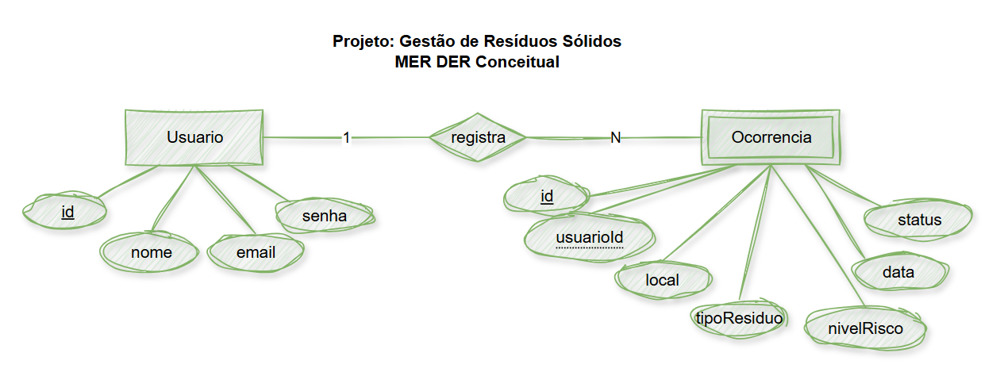
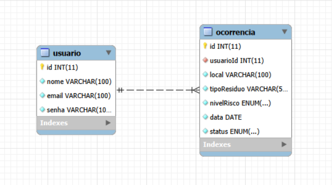

---

## 🛠️ Tecnologias Utilizadas
* **Node.js** (Ambiente de execução JavaScript)
* **Express** (Framework web para Node.js)
* **MariaDB / MySQL** (Banco de dados relacional via XAMPP)
* **CORS** (Middleware para controle de acesso HTTP)
* **Thunder Client / Postman / Insomnia** (Testes de API)

---

## 🚀 Passo a Passo para Testar

1. **Pré-requisitos:**
   * Tenha o **Node.js** e o **XAMPP** instalados na sua máquina.
   * Inicie o serviço **MySQL** no painel de controle do XAMPP.

2. **Configurar o Banco de Dados:**
   * Abra o MySQL Workbench ou outra ferramenta de sua preferência.
   * Execute o script localizado na pasta do projeto: `./db/sript.sql`.

3. **Instalar as Dependências:**
   * Abra o terminal na pasta raiz do projeto e execute:
     ```bash
     npm install
     ```

4. **Executar a Aplicação:**
   * Inicie o servidor em modo de desenvolvimento com o comando:
     ```bash
     npm run dev
     ```
   * O servidor rodará em: `http://localhost:3000`.

---

## 🧪 Prints dos Testes (Thunder Client)

### 📌 Testes de Rotas e Usuários
* **Teste da Rota Inicial:**
  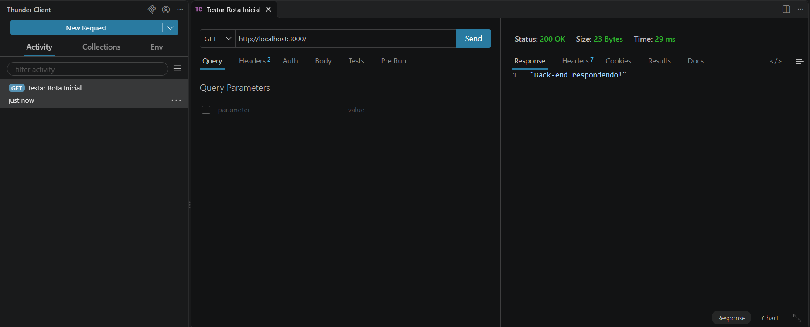

* **Cadastrar Usuário:**
  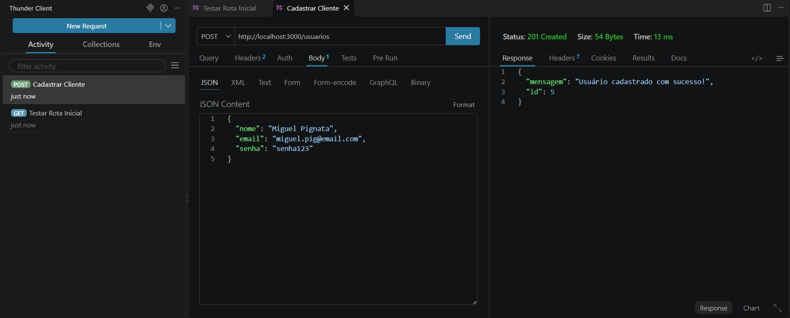

* **Listar Usuários:**
  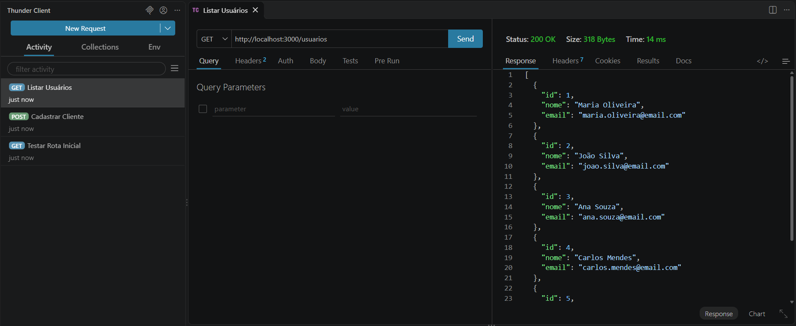

* **Atualizar Usuário:**
  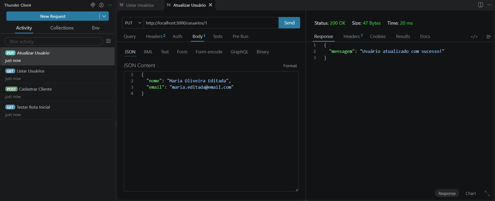

* **Testar Login:**
  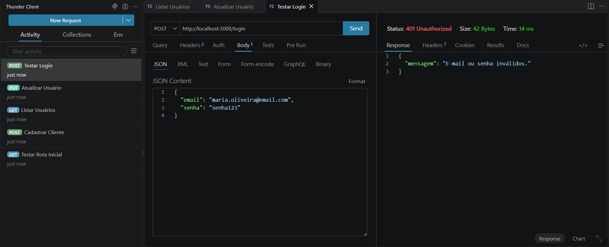

---

### 📌 Testes de Ocorrências
* **Cadastrar Ocorrência:**
  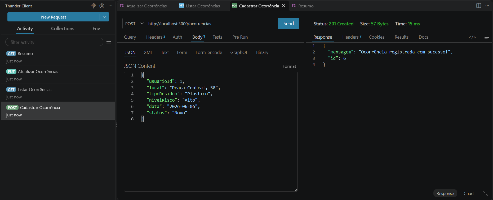

* **Listar Ocorrências:**
  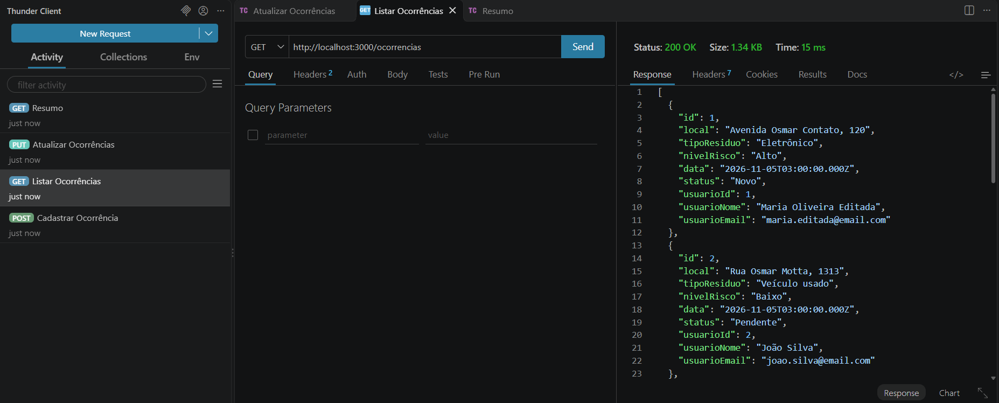

* **Atualizar Ocorrência:**
  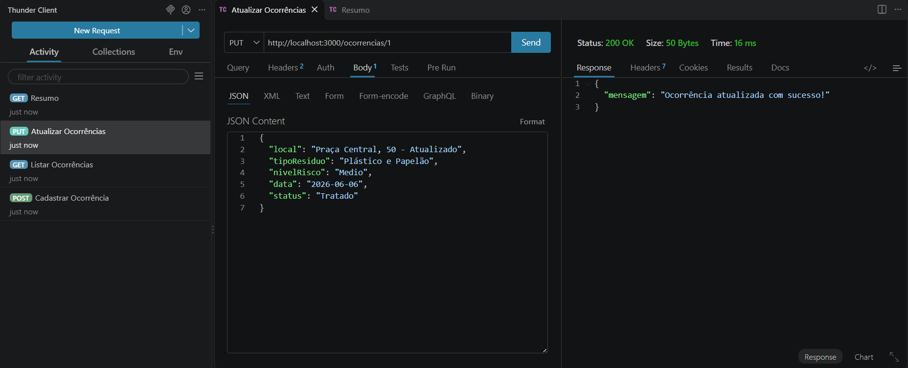

* **Resumo de Ocorrências Tratadas:**
  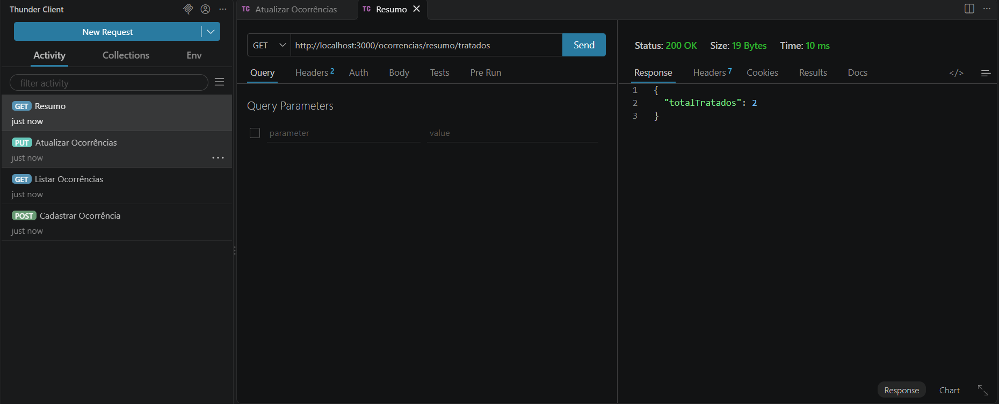
