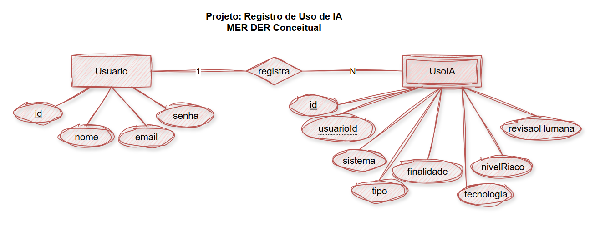
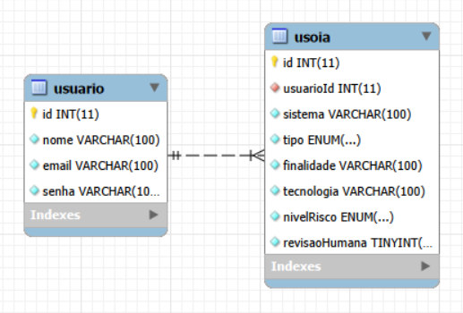
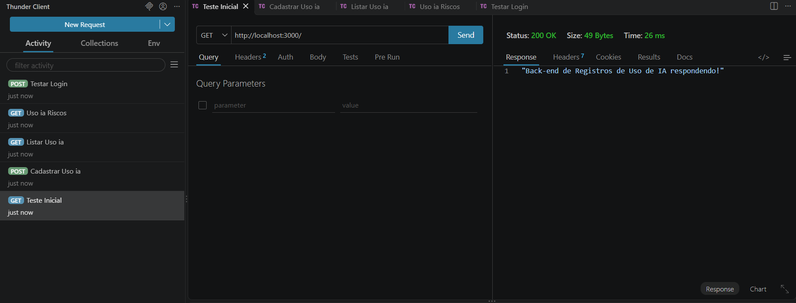
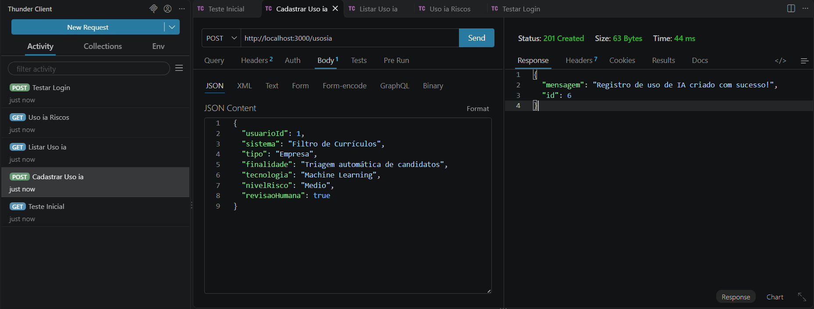
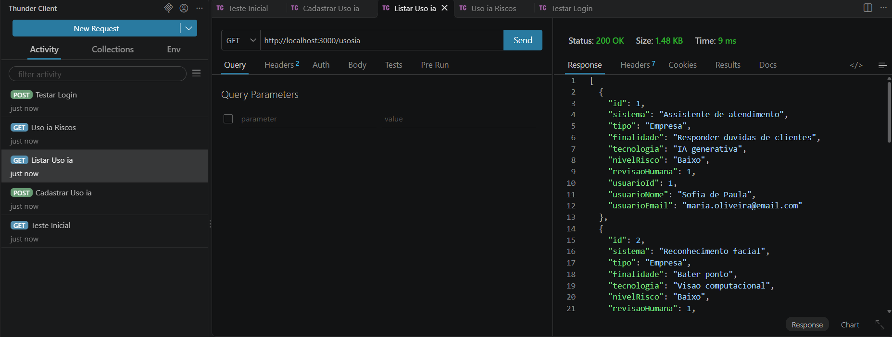
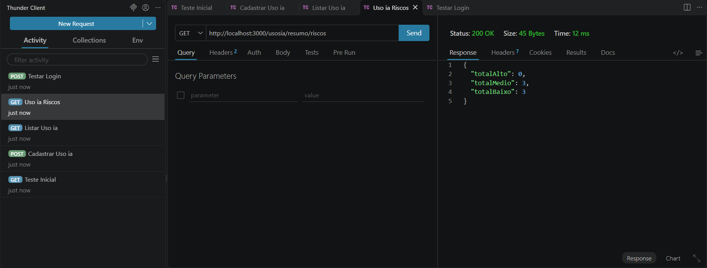
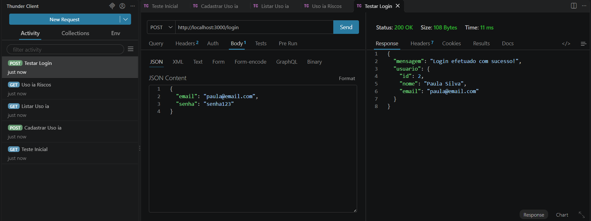

# Registros de uso de IA

## 📖 Descrição
Desenvolvido para atender a uma demanda de pesquisa da Faculdade de Jauariúna, este sistema tem como objetivo catalogar e monitorar o uso de Inteligência Artificial em empresas, escolas e outros setores. A aplicação registra finalidades, tecnologias, revisões humanas e níveis de risco, oferecendo uma visão organizada sobre a adoção dessas tecnologias. O projeto foi desenvolvido em aula visando estudo e desenvolvimento de habilidades no curso *Desenvolviemento de Sistemas SENAI*.

---

## 📊 Diagrama de Classes / DER
O diagrama de entidades e relacionamentos (MER DER) modela as tabelas de `usuario` e `Uso Ia`:




---

## 🛠️ Tecnologias Utilizadas
* **Node.js** (Ambiente de execução JavaScript)
* **Express** (Framework web para Node.js)
* **MariaDB / MySQL** (Banco de dados relacional via XAMPP)
* **CORS** (Middleware para controle de acesso HTTP)
* **Thunder Client / Postman / Insomnia** (Testes de API)

---

## 🚀 Passo a Passo para Testar

1. **Pré-requisitos:**
   * Tenha o **Node.js** e o **XAMPP** instalados na sua máquina.
   * Inicie o serviço **MySQL** no painel de controle do XAMPP.

2. **Configurar o Banco de Dados:**
   * Abra o MySQL Workbench ou outra ferramenta de sua preferência.
   * Execute o script localizado na pasta do projeto: `./db/sript.sql`.

3. **Instalar as Dependências:**
   * Abra o terminal na pasta raiz do projeto e execute:
     ```bash
     npm install
     ```

4. **Executar a Aplicação:**
   * Inicie o servidor em modo de desenvolvimento com o comando:
     ```bash
     npm run dev
     ```
   * O servidor rodará em: `http://localhost:3000`.

---

## 🧪 Prints dos Testes (Thunder Client)

* **Teste da Rota Inicial:**
  

* **Cadastrar Usuário:**
  

* **Listar:**
  

* **Listar Riscos:**
  

* **Testar Login:**
  
